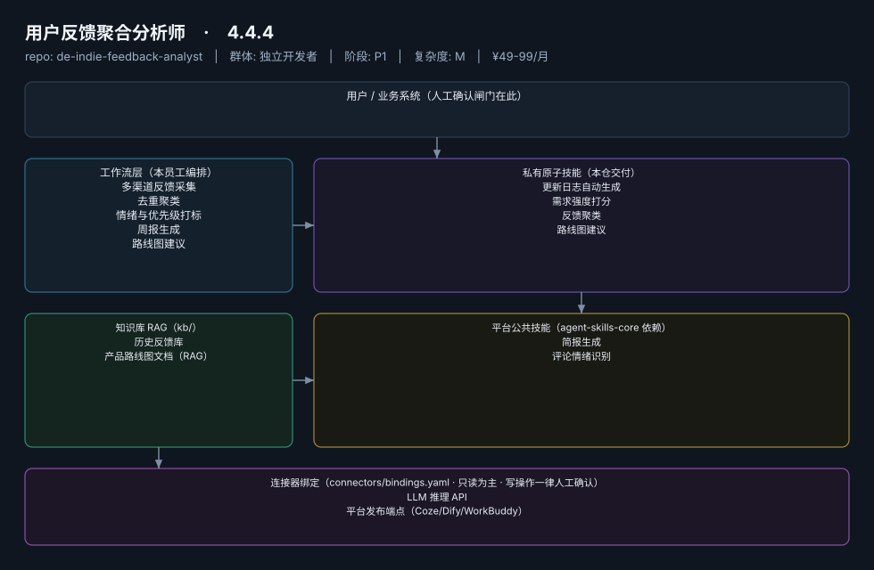
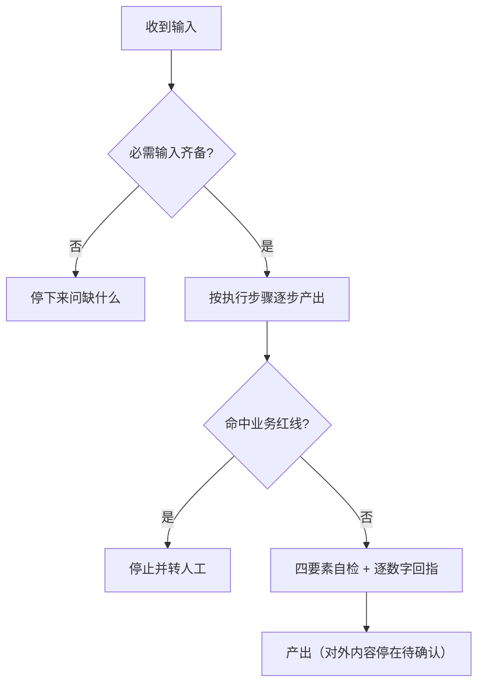
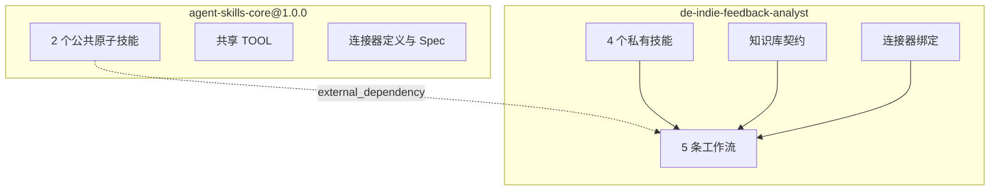

# 04 · 架构与流程图

## 分层架构



- **工作流层（L2）**：本员工编排，共 5 条
- **私有原子技能层（L1）**：本仓交付，共 4 个
- **公共技能层**：来自 `agent-skills-core@1.0.0`，本仓只引用
- **知识库 / 连接器**：RAG 语料与外部系统绑定，写操作一律人工确认

## 工作流 → 技能调用图

```mermaid
graph LR
    U["用户 / 业务系统"] --> A["用户反馈聚合分析师"]
    A --> W1["多渠道反馈采集"]
    A --> W2["去重聚类"]
    A --> W3["情绪与优先级打标"]
    A --> W4["周报生成"]
    A --> W5["路线图建议"]
    W{i} --> S{j}["数据对接"]
    W{i} --> S{j}["反馈聚类"]
    W{i} --> S{j}["评论情绪识别"]
    W{i} --> S{j}["需求强度打分"]
    W{i} --> S{j}["简报生成"]
    W{i} --> S{j}["需求强度打分"]
    W{i} --> S{j}["路线图建议"]
```

## 主线流程（多渠道反馈采集）



## 仓库边界


