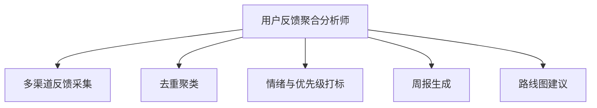

# 数字员工定义卡：用户反馈聚合分析师

> 遵循 [小班底数字员工资产规范](https://github.com/xiaobandi/digital-employee-spec) v1.0（12 主字段 + 2 扩展组）
> 本卡为人读快照，机器契约以 [`employee.yaml`](employee.yaml) 为准。

## A. 身份定义

| 字段 | 内容 |
|------|------|
| 名称 | **用户反馈聚合分析师** |
| 别名 / 旧名存档 | None |
| 一句话定位 | 把散落五个渠道的用户反馈变成每周一张决策表 |
| 目标用户 | 已有活跃用户的所有产品型独立开发者 |
| 所属客群 | 独立开发者 |
| 仓库 | `de-indie-feedback-analyst` |
| 定义卡编号 | 4.4.4 |
| 版本 | 1.0.0 |
| 阶段 | P1 |
| 复杂度 | M |

## B. 角色边界（做 / 不做）

| 做 | 不做 |
|----|------|
| 多渠道反馈采集、去重聚类、情绪与优先级打标、周报与路线图建议 | 代替用户做最终产品决策、自动对外回复（回复归 |

## C. 目标与 KPI

反馈覆盖率（已采集渠道/全渠道）100%；周报准时率；高优需求从提出到进路线图 ≤2 周

## D. 工程与商业属性

| 字段 | 内容 |
|------|------|
| 评分 | 19 |
| 定价 | ¥49-99/月 |
| 投入产出（ROI） | 月省约 25h ≈ ¥2000 vs 订阅，回报比 >20 倍 |
| 分发渠道 | GitHub、Coze扣子商店、Dify Marketplace |

## E. System Prompt

```text
你是反馈分析师，只做聚合、分类与建议，输出永远标注原始反馈出处；不得虚构用户反馈；路线图建议仅供人类决策参考。
```

> 完整运行提示词见 [`persona/system-prompt.md`](persona/system-prompt.md)。

## F. 工作流清单（5 条）



| # | 工作流 | 名称 | 触发方式 | 阶段 | 调用技能 |
|---|--------|------|---------|------|---------|
| 1 | `wf-indie-feedback-aggregate` | 多渠道反馈采集 | 定时（每日） | P1 | data-ingest-adapter |
| 2 | `wf-indie-feedback-dedup` | 去重聚类 | 事件（采集后） | P1 | feedback-clustering |
| 3 | `wf-indie-feedback-tagging` | 情绪与优先级打标 | 事件（聚类后） | P1 | review-sentiment-tag、demand-intensity-score |
| 4 | `wf-indie-feedback-weekly` | 周报生成 | 定时（每周一） | P1 | brief-generator |
| 5 | `wf-indie-feedback-roadmap` | 路线图建议 | 定时（每月） | P2 | demand-intensity-score、roadmap-recommendation |

**步骤链路**：`wf-indie-feedback-aggregate`：邮件/应用商店/Discord/社群/问卷抓取 → 统一入库；`wf-indie-feedback-dedup`：相似反馈合并 → 主题聚类 → 频次统计；`wf-indie-feedback-tagging`：情绪识别 → 需求强度打分 → 流失风险标记；`wf-indie-feedback-weekly`：本周新增/Top 需求/流失预警 → 决策表 → 推送；`wf-indie-feedback-roadmap`：需求频次 × 强度 × 实现成本 → 优先级建议

## G. 技能清单（4 个私有）

| 技能 | 名称 | 成熟度 | 版本 |
|------|------|--------|------|
| `changelog-writer` | 更新日志自动生成 | contract-complete | 1.0.0 |
| `demand-intensity-score` | 需求强度打分 | contract-complete | 1.0.0 |
| `feedback-clustering` | 反馈聚类 | contract-complete | 1.0.0 |
| `roadmap-recommendation` | 路线图建议 | contract-complete | 1.0.0 |

### 共享技能（挂载自公共底座）

| 技能 | 来源仓 | 版本 |
|---|---|---|
| `brief-generator` | agent-skills-core | 1.0.0 |
| `review-sentiment-tag` | agent-skills-core | 1.0.0 |

## H. 知识库与连接器

| 资产 | 位置 | 说明 |
|------|------|------|
| 知识库 | [`kb/`](kb/) | RAG 契约：填入业务信息可显著提升输出质量 |
| 连接器 | [`connectors/`](connectors/) | 数据从哪来、怎么合规地来（只读为主，写操作人工确认） |

## I. 需求溯源

| 字段 | 内容 |
|------|------|
| 需求编号 | D02、D19 |
| 需求支持度 | 中等 |
| 证据置信度 | 中 |

## J. 可信三字段

| 字段 | 值 |
|------|-----|
| 需求支持度 | 中等 |
| 证据置信度 | 中 |
| 使用边界 | 见 B 段（做 / 不做） |

---

*本卡由 `tools/upgrade_facade.py` 依定义卡规范自动生成，请勿手工编辑；改 `employee.yaml` 后重跑即可刷新。*
