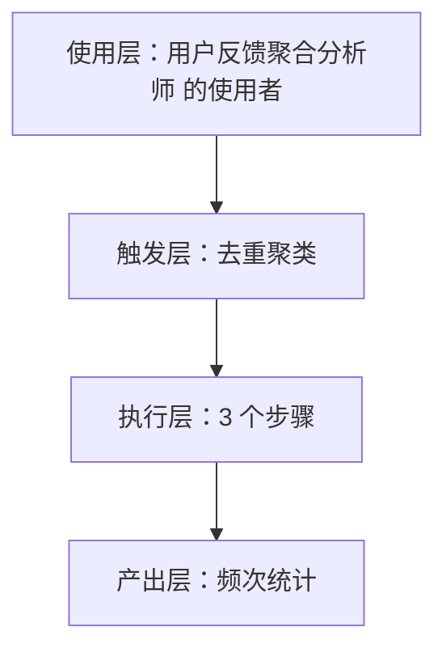
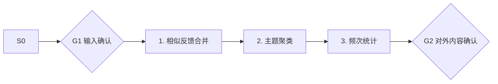

# 去重聚类 · 架构与流程图

## 本工作流的四层结构

| 层 | 内容 |
|---|---|
| 使用层 | 已有活跃用户的所有产品型独立开发者；员工定位：把散落五个渠道的用户反馈变成每周一张决策表 |
| 触发层 | 关键词 / 显式点名「去重聚类」；触发方式：事件（采集后） |
| 执行层 | 相似反馈合并 → 主题聚类 → 频次统计 |
| 产出层 | 频次统计 |

## 执行流程

## 步骤职责表

| # | 步骤 | 承担者 | 为什么 |
|---|---|---|---|
| 1 | 相似反馈合并 | 模型 | 需要读懂语境，不可用固定规则替代 |
| 2 | 主题聚类 | 模型 | 需要读懂语境，不可用固定规则替代 |
| 3 | 频次统计 | 模型 | 需要读懂语境，不可用固定规则替代 |

⚠️ 尚未补齐：图中的步骤来自注册表口径，未逐条实跑校验；实跑后请同步修订本页（`发布标准.md` 第六项：通读一遍，不得出现重复填充句）。
